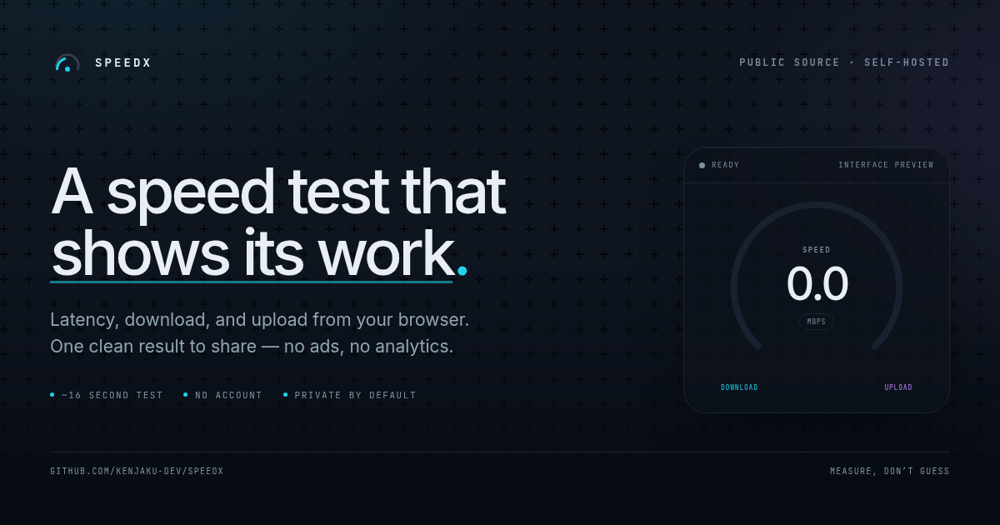

<p align="center">
  <a href="https://kenjaku-dev.github.io/SpeedX/">
    
  </a>
</p>

<h1 align="center">SpeedX</h1>

<p align="center">
  A browser speed test that shows its work.<br />
  <a href="https://kenjaku-dev.github.io/SpeedX/">Project page</a> ·
  <a href="https://github.com/kenjaku-dev/SpeedX/issues">Issues</a>
</p>

SpeedX measures latency, download, and upload from the browser, then saves each completed test as a compact, shareable result page when storage is available. The method and the data model are kept visible.

> [!NOTE]
> The [project page](https://kenjaku-dev.github.io/SpeedX/) is static and lives on GitHub Pages. GitHub Pages cannot run the measurement API, Web Worker, or SQLite store, so the live test must run on a Node host. There is no hosted demo URL in this repository.

## What it does

- Measures ping, jitter, packet loss, download, and upload in one pass.
- Runs ping first, then four download streams and three upload streams.
- Uses random, incompressible download payloads and generated upload payloads.
- Saves a result to SQLite and gives it a short, shareable URL.
- Keeps shared result pages out of search indexes.
- Works with keyboard and screen readers, and respects reduced-motion preferences.
- Has no accounts, ads, cookies, or analytics.

## How a test runs

| Phase | Length | What happens |
| --- | --- | --- |
| Ping | 10 round trips | The browser times requests to the server. The average is ping; the average change between samples is jitter; failed requests become packet loss. |
| Download | 8 seconds, 4 streams | Parallel requests pull pre-generated random chunks. Bytes are counted as they arrive, and chunk size grows with the measured rate. |
| Upload | 8 seconds, 3 streams | The browser sends generated data; the server reads and discards it. Payload size follows the measured rate. |

The browser test measures one path to one server, not the rate on your internet plan. Run it more than once before drawing a conclusion.

## Stack

- Next.js 15 with the App Router
- React 19 and TypeScript
- A dedicated Web Worker for the test loop
- `better-sqlite3` for local result storage
- Tailwind CSS tokens and shadcn primitives
- A dependency-free static project page under `docs/`

## Run locally

**Requirements:** Node.js 22+ and npm.

```bash
npm install
cp .env.example .env.local
npm run dev
```

Open <http://localhost:3000>.

Optional checks:

```bash
npm run lint
npm run build
```

The database is created automatically. If `SPEEDX_DB_PATH` is not set, the app first tries `./data/speedx.db`, then falls back to the operating system temp directory when the project directory is not writable.

### Environment variables

| Variable | Required | Purpose |
| --- | --- | --- |
| `NEXT_PUBLIC_SITE_URL` | For production | Absolute origin used by metadata, `robots.txt`, and `sitemap.xml`. Set it before `next build` so statically rendered metadata uses the public URL. |
| `SPEEDX_DB_PATH` | Optional | Writable SQLite file path. Use a persistent volume in production. |

## Deploy the actual test

The measurement API needs a Node.js runtime and a writable disk.

```bash
NEXT_PUBLIC_SITE_URL="https://speed.example.com" \
SPEEDX_DB_PATH="/var/lib/speedx/speedx.db" \
npm run build

npm start
```

The build uses Next.js `standalone` output. Keep the SQLite file on a persistent volume; a read-only or ephemeral filesystem will lose shared results on the next deploy. Do not deploy the app to a purely static host.

## Project page (GitHub Pages)

The static project page is in [`docs/`](docs/). It contains no API calls and no fabricated live results; the interface preview is explicitly labelled as sample data.

- Workflow: [`.github/workflows/pages.yml`](.github/workflows/pages.yml)
- URL: <https://kenjaku-dev.github.io/SpeedX/>
- Source: <https://github.com/kenjaku-dev/SpeedX>

Preview it locally:

```bash
python3 -m http.server 4173 --directory docs
```

Then open <http://localhost:4173/>. The page uses relative asset paths, so it also works when served from the `/SpeedX/` project subpath.

To deploy, push a change under `docs/` (or run the workflow manually). The workflow uses GitHub's Pages actions and the `github-pages` environment. In repository settings, Pages must use **GitHub Actions** as its source; the workflow requests that configuration when Pages is not already enabled.

## Privacy and data

A saved result contains the measurements, ISP, approximate city and country, server name, and timestamp. It does not persist the connecting IP address, user agent, name, or account. The IP lookup runs when the test page loads; ISP and city come from a third-party lookup of that IP.

Result pages are readable by anyone with the link and are marked `noindex`. They are not private in the sense of access control.

## Repository layout

```text
app/                  Next.js routes and API route handlers
components/           Test UI, gauge, header, result components
workers/              Speed-test Web Worker
lib/                  Site config, formatting, SQLite, result queries
docs/                 Static GitHub Pages project page
.github/workflows/    Pages deployment
```

## License

No license file has been added yet. The source is public to view, but that is not the same as open source, and it is not a grant of rights to reuse or redistribute the code. Add a license before doing so.

---

Project made by **Achraf**.
